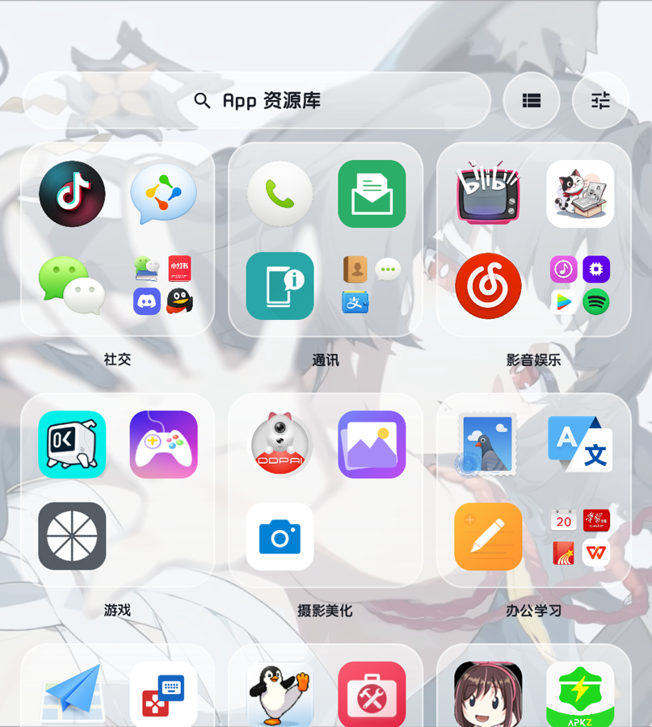
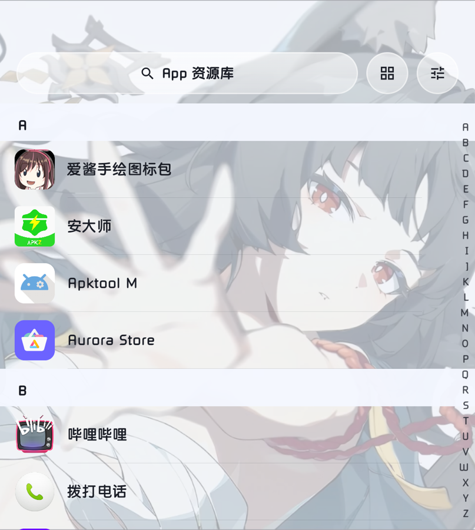
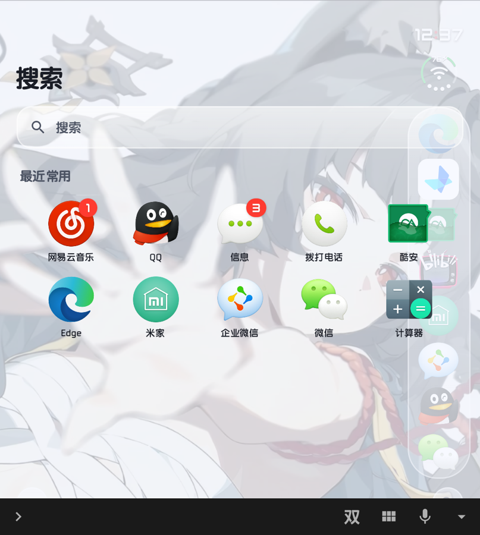
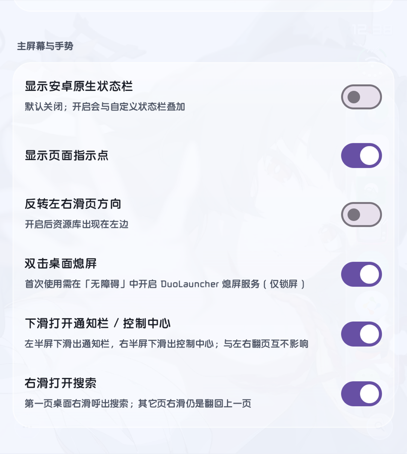
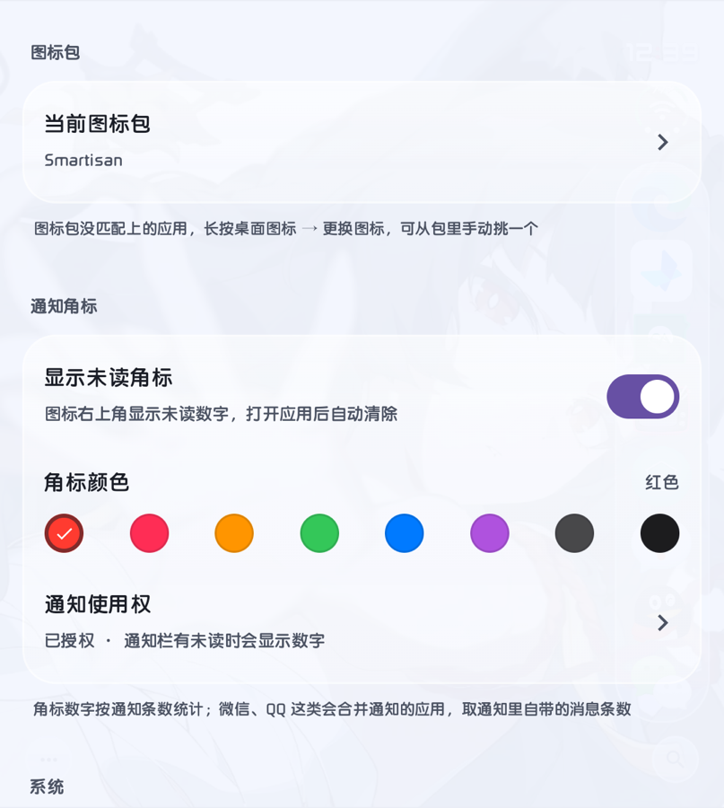
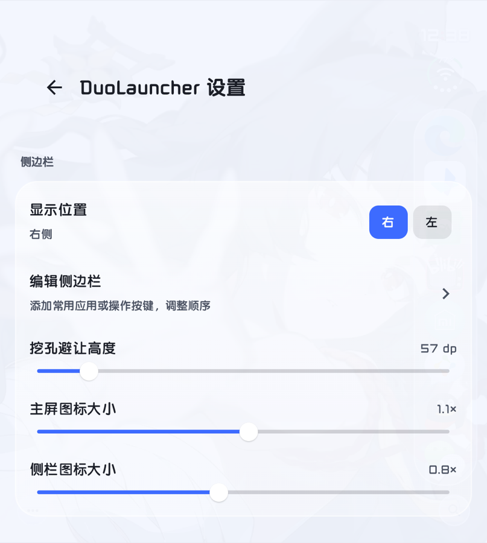
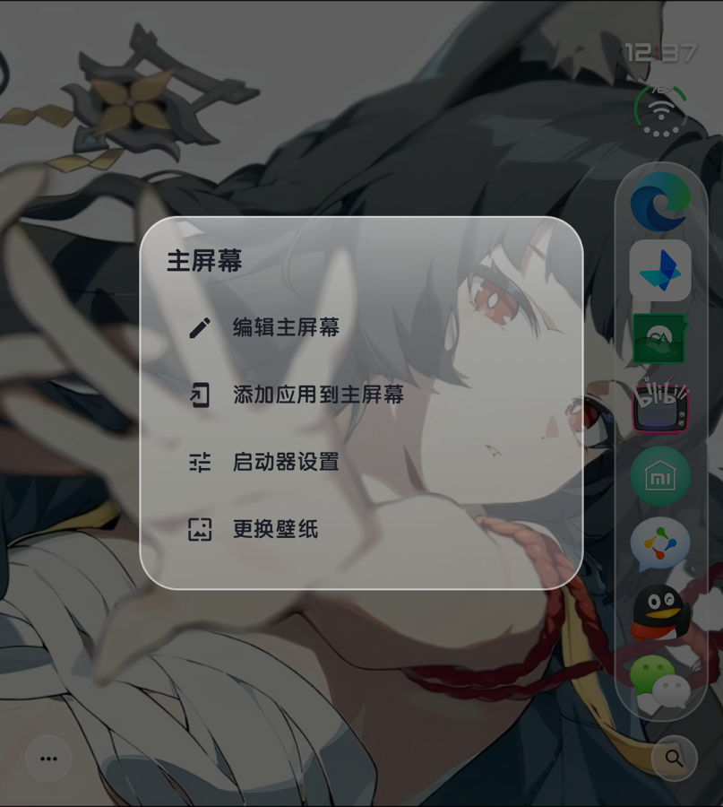

# DuoLauncher

[简体中文](README.md) | **English**

An Android home screen launcher written in Kotlin + Jetpack Compose, with an iOS-inspired glass aesthetic, hand-tuned for the **Unihertz Titan 2 Elite** (near-square 1080×1200 display, top-left punch-hole camera, physical keyboard).

This is not a theme or an icon pack — it is a complete launcher (`android.intent.category.HOME`) and can be set as your default home app.

[](https://github.com/d3ja7u/DuoLauncher/releases)
[](LICENSE)

<p align="center">
  
  
  
  
</p>

<p align="center">
  
  
  
  
</p>

> All screenshots were taken on a Unihertz Titan 2 Elite (v1.3.8) and show the Chinese UI. The interface language follows the device or can be changed in Settings → System → Language.

---

## 1. Features

| Feature | Details |
|---|---|
| Glassmorphism | Live-blurred glass for the sidebar, search pill and settings cards; adjustable blur intensity and light/dark glass |
| iOS-style status bar | Time + arc signal + Wi-Fi dots replaces the Android status bar; switchable side, 12/24-hour clock |
| Sidebar dock | A vertical column of favorite apps on the right (or left); fully editable, reorderable, with its own icon scale |
| App Library | Category cards plus an iOS-style A–Z list; the right-hand index bar supports tap and drag |
| Unified search | Apps + phone contacts + web search in one place; Enter opens the first result, web search opens in the default browser |
| Notification badges | Unread counts on icons, Apple-style outlined bubbles, 8 colors |
| Gestures | Split swipe-down for notifications / quick settings, swipe right for search, double-tap to sleep |
| Icon packs | Third-party packs (e.g. Smartisan) with per-app manual icon override |
| Category management | Automatic grouping by app type, manual per-app override, hide apps |
| **Multilingual UI** | Simplified Chinese, English and Japanese; follows the device language automatically, with a manual override in Settings |
| **Clean start** | A fresh install leaves the home screen grid empty; you decide what goes on it |
| **Settings backup** | Export / import a JSON file covering home layout, sidebar, folders, categories, icons, language and every other setting |
| **Long-press to open Settings** | Long-press empty home area to jump straight into Launcher Settings — no need to tap the bottom-left menu first |
| **Hide bottom icons** | The bottom-left settings icon and bottom-right search icon can be hidden in Settings → Home Screen & Gestures; after hiding, long-press still opens Settings and swipe-right on the leftmost page still opens Search |

---

## 2. Usage

### 2.1 Home screen

- **A fresh install starts empty**: no app icons are placed on the home grid (the default sidebar is still there). To add one, tap `···` in the bottom-left → **Add App to Home**, or long-press an app in the App Library. Upgrading an existing setup never clears your icons.
- **Open an app**: tap its icon.
- **Change page**: swipe left or right. By default, swiping right goes back one page; swiping right on the leftmost page opens Search (see Gestures).
- **Move / reorder icons**: long-press and drag; the grid makes room automatically.
- **Edit Home Screen**: tap `···` in the bottom-left → **Edit Home Screen**. Icons jiggle and an iOS-style `-` badge appears at their top-left. Tapping `-` offers **Remove from Home Screen / Uninstall / Cancel** — removing from the Home Screen only sends the icon back to the App Library and does **not** uninstall the app. Long-pressing an icon still opens the full menu (change icon / app info / uninstall). Tap the menu item again to exit.
- **Home menu** (bottom-left `···`): Edit Home Screen / Add App to Home / Launcher Settings / Change Wallpaper.
- **Long-press empty home area**: opens Launcher Settings directly.
- **Hide bottom icons**: both the bottom-left `···` and the bottom-right search icon can be turned off in Settings → Home Screen & Gestures; after that, long-press still opens Settings and swipe-right on the leftmost page still opens Search.

### 2.2 Sidebar

A vertical strip of frequently used apps on the right edge. Tap to launch. Spacing tightens automatically as you add icons, so the search button in the bottom-right stays clear.

- Show / hide: Settings → Sidebar → **Show sidebar**. When off, home icons use the full width; the status indicator stays.
- Position: Settings → Sidebar → Position (Right / Left).
- Contents: Settings → Sidebar → Edit Sidebar — add apps or action buttons, drag to reorder.
- Size: Settings → Sidebar → Sidebar icon size (separate from home icon size).
- Long-press a sidebar icon: Edit Sidebar / Remove from Sidebar / App Info.

### 2.3 App Library

Swipe left from the home screen (or right, if **Reverse swipe direction** is enabled). Two **mutually exclusive** views:

| View | Content | How to switch |
|---|---|---|
| Category cards | 3-column glass cards, each holding apps of one category | Tap the list icon in the top-right, or pull down at the top of the page |
| A–Z list | Full-screen iOS-style grouped list | Tap the grid icon, or pull down at the top of the page |

- In card view, tapping empty space in a card (or its 4th folder slot) opens all apps in that category.
- The A–Z index bar on the right supports **tap and vertical drag**; a large letter bubble appears on hit. It only exists in list view and fades in after the content has scrolled.
- Pull-to-switch only fires when the list is **already at the top**, so scrolling back up from the middle won't trigger it by accident.
- Chinese app names are grouped by **pinyin initial** (爱酱 → A, 哔哩哔哩 → B). Numbers and symbols go to `#`, always last.

### 2.4 Search

Open it by **swiping right on the home screen**, tapping the magnifier in the bottom-right, or swiping right on the leftmost page.

- **Apps**: filters names and package names as you type. With an empty query it shows **Recent** apps — the count is configurable (5 / 10 / 15 / 20).
- **Contacts**: matches names and phone numbers (the Contacts permission is requested on first use). Tap a row to open the contact, tap the phone icon to dial directly.
- **Web search**: a "Search with Baidu / Bing / Google" row at the bottom. Tapping it — or pressing Enter when no app or contact matches — opens the **system default browser**; there is no embedded web view.
- **Enter = first result**: pressing Search / Enter on the keyboard opens the first result in order (app → contact → web search).
- **Search settings**: the gear in the top-right of the search page, or Settings → Search, controls the recent count, search engine and contact toggle. Both edit the same state.
- To close: **swipe left**, **swipe up**, or press **Back**. The IME is explicitly hidden on close, so no keyboard toolbar is left behind on the home screen.

### 2.5 Gestures

| Gesture | Action | Notes |
|---|---|---|
| Swipe left / right | Change page | App Library sits at the far right (or far left) |
| **Swipe right (leftmost page)** | Open Search | On other pages it still goes back one page |
| **Swipe down · left half** | Notifications | Fires after ≥ 96dp of accumulated travel |
| **Swipe down · right half** | Quick Settings | The half where the gesture starts decides which panel opens |
| **Double-tap empty area** | Sleep | Requires the accessibility service |
| **Long-press empty area** | Enter Launcher Settings | Direct entry to Settings; still the main way in after hiding the bottom icons |

> The swipe-down handler only claims vertical drags. It does not interfere with page swipes or icon long-press drags, and short swipes are ignored.

### 2.6 Notification badges

1. Settings → Notification Badges → grant **Notification access** (`NotificationListenerService`).
2. Enable **Show unread badges** and pick a color (red / pink / orange / green / blue / purple / graphite / black).
3. A number appears on the icon and clears when you open the app.

Counting: most apps count notifications; apps that bundle them (WeChat, QQ) use the notification's own `android.number` value.

### 2.7 App context menu (long-press)

In edit mode or in the App Library, long-press an icon to:

- Add to Home Screen (most useful when the home screen is empty)
- Change Icon (pick manually from the active icon pack)
- App Info (system app details page)
- Uninstall

---

## 3. Settings

| Section | Items |
|---|---|
| Sidebar | Show sidebar, Position, Edit Sidebar, Cutout top padding, Home icon size, Sidebar icon size |
| Search | Recent apps count (5 / 10 / 15 / 20), Search engine (Baidu / Bing / Google), Search contacts |
| iOS-style Status Bar | Show time and arc signal, Position, 24-hour clock, Signal dots follow real strength, Top offset, Status bar size |
| Home Screen & Gestures | Show Android status bar, Show page indicators, Reverse swipe direction, Double-tap to sleep, Swipe down for notifications / quick settings, Swipe right to search, Bottom-left settings icon, Bottom-right search icon |
| App Library | Smart categories, Edit App Category, Hide App |
| Appearance | Glass blur intensity, Dark glass |
| Icon Pack | Current icon pack (auto-detects installed packs) |
| Notification Badges | Show unread badges, Badge color, Notification access |
| Updates | Check for updates, In-place download & install, Auto-check for updates, Update source, Open project page |
| Privacy and statistics | Anonymous statistics toggle, local anonymous ID, endpoint, View statistics |
| Backup and restore | Export settings, Import settings |
| System | **Language**, Set as default launcher, Change Wallpaper, DuoLauncher app info, About |

Open it from the home screen: bottom-left `···` → Launcher Settings, or long-press an empty home area.

### 3.1 Language

DuoLauncher ships with **Simplified Chinese**, **English** and **Japanese**.

- By default it **follows the device language** — including per-app language set in Android 13+ system settings. Other device locales fall back to Chinese.
- To override: Settings → System → **Language** → choose Follow system / 简体中文 / English / 日本語. The change applies immediately and Settings stays open so you can see the result.
- The choice is persisted locally and survives restarts. A manual choice always takes priority over the device language; pick **Follow system** to give control back to the system.
- App labels, category names, dates and weekday names follow the active language. User data you created (folder names, notes) is never translated.

Translations live in `app/src/main/res/values/`, `values-en/` and `values-ja/`. `util/Lang.kt` handles locale switching and exposes `Lang.s()` for string lookups outside composables.

### 3.2 Backup and restore

Settings → **Backup and restore**:

- **Export settings**: opens the system "Save file" dialog. The suggested name is `DuoLauncher-backup-YYYYMMDD-HHmm.json` and you choose where it goes (local storage, cloud drive, another device).
- **Import settings**: pick a previously exported JSON. A summary is shown first (export time, version, counts of home icons / sidebar items / folders / hidden apps / widgets); only after confirming does it replace the current configuration and restart the launcher.

A backup holds the full local configuration: home layout and order, sidebar, folders, hidden apps, categories and per-app icon overrides, icon pack, appearance and gestures, badge settings, search settings, UI language, update source and update-check records. It **does not** contain the anonymous statistics ID (kept separately, so importing someone else's backup cannot mix IDs), badge read state, wallpaper images, app data, contacts or accounts. The file is written only to the location you pick — nothing is uploaded, and importing reads only that one file.

Import **replaces everything**; there is no per-item selection, so export your current setup first. When restoring on another device, icons referencing apps that are not installed there are skipped; the rest of the layout is preserved.

---

## 4. Permissions & privacy

| Permission / service | Purpose | Required? |
|---|---|---|
| Notification access | Read unread counts for badges | Only for badges |
| Accessibility (DuoLauncher Sleep Service) | Double-tap to sleep; fallback path for opening system panels | Only for double-tap sleep |
| `EXPAND_STATUS_BAR` | Expand notifications / quick settings | Normal permission, granted at install |
| `QUERY_ALL_PACKAGES` | List and launch installed apps | Required |
| `READ_CONTACTS` | Match phone contacts in search results | Optional, requested on demand |
| `REQUEST_DELETE_PACKAGES` | Uninstall apps | Optional |
| `REQUEST_INSTALL_PACKAGES` | Opens the system installer for in-place updates (requires granting Install unknown apps in system settings) | Optional, only when you tap Download and install |
| `INTERNET` | Update checks, in-place downloads and optional anonymous statistics | Optional; no business requests when both are disabled |
| `BIND_APPWIDGET` | Host home screen widgets | Optional |

Layouts and preferences are stored locally in `SharedPreferences`. There are no accounts and the app never reads or uploads personal content. **The only data that can leave the device is the opt-out anonymous usage statistic** (random ID + version + UI language + Android API level + report type): you are asked once on first launch, and Settings → Privacy and statistics can turn it off at any time, which immediately deletes the local anonymous ID. See [PRIVACY.md](PRIVACY.md) for details.

---

## 5. Building

Requirements:

- JDK 17
- Android SDK Platform 34 (`compileSdk = 34`)
- Gradle 8.9 (provided by the wrapper)

```bash
git clone https://github.com/d3ja7u/DuoLauncher.git
cd DuoLauncher

# Point to your local Android SDK (this file is not committed)
echo "sdk.dir=$HOME/Library/Android/sdk" > local.properties

./gradlew assembleDebug
# Output: app/build/outputs/apk/debug/app-debug.apk

# Distributable build (release variant: R8 + resource shrinking, ~2.1 MB, not debuggable)
./gradlew assembleRelease
# Output: app/build/outputs/apk/release/app-release.apk
```

You can also open the project root in Android Studio (Koala or newer).

**Dependency mirrors**: `settings.gradle.kts` includes Aliyun mirrors for faster builds in mainland China. If you build outside China, remove the `maven { url = uri("https://maven.aliyun.com/...") }` lines and keep `google()` / `mavenCentral()`.

Version matrix:

| Component | Version |
|---|---|
| AGP | 8.5.2 |
| Kotlin | 1.9.24 |
| Compose BOM | 2024.06.00 |
| Gradle | 8.9 |
| compileSdk / targetSdk | 34 |
| minSdk | 28 (Android 9) |

---

## 6. Known limitations

- **Tuned for a square screen**: spacing, status bar position and cutout padding assume 1080×1200 / density 331. It runs on ordinary 20:9 phones, but glass card padding and grid density will need tweaking in `DuoState`.
- **Pinyin grouping** uses `Transliterator("Han-Latin")`; polyphonic characters follow ICU's default reading, so a few names may land in the wrong group.
- **Quick Settings expands in one step**: from Android 16, `expandSettingsPanel()` opens the full tile panel with no intermediate "peek" state. Use the left half of the screen for notifications.
- **Widget host**: `AppWidgetHost` is implemented, but the add-widget entry point lives on the currently disabled Today page.
- Signal strength buckets come from `TelephonyManager` / `WifiManager`; some ROMs report full strength at all times.

---

## 7. Changelog

| Version | Changes |
|---|---|
| 1.5.6 | Opt-out anonymous usage statistics: first-launch notice, Settings toggle / endpoint / View statistics, turning it off deletes the local ID; bundled zero-dependency stats server; privacy policy rewritten in three languages |
| 1.5.5 | In-place updates: download progress, cancel, install-permission guidance, private cache + FileProvider, fallback to download page; Atom fallback now derives the APK link too |
| 1.5.0 | Multilingual UI: Chinese / English / Japanese, follows the device language, manual override in Settings; this English README |
| 1.4.1 | Solid background for the update-source dialog, long URLs wrap, whitespace stripped on save |
| 1.4.0 | New Updates section: configurable GitHub Releases source, manual / silent auto check, fallback to the official Atom feed |
| 1.3.9 | Automated releases: pushing a tag builds and publishes the APK via GitHub Actions; CI builds share the local debug signature |
| 1.3.8 | "About" version is read from package info |
| 1.3.7 | Search placeholder simplified |
| 1.3.6 | Removed the search close button; swipe left / up / Back still close |
| 1.3.5 | Swipe-left to close search, removed the footer hint |
| 1.3.4 | Swipe right on the home screen opens search (leftmost page only) |
| 1.3.3 | Split swipe-down: left half for notifications, right half for quick settings |
| 1.3.2 | Removed swipe-down search; fixed the IME toolbar lingering after closing search |
| 1.3.1 | App Library split into two exclusive views (cards / A–Z), wider index bar, fixed letter ordering |
| 1.3.0 | iOS-style A–Z list and index bar in the App Library |
| 1.2.x | Glass refinements, notification badges, status bar position, Today page retired |

---

## 8. Downloads and releases

**Don't want to build it?** Grab `DuoLauncher-x.y.z.apk` from [Releases](https://github.com/d3ja7u/DuoLauncher/releases).

Releases are fully automated by `.github/workflows/release.yml`: bump the version, push a `v*` tag, and Actions compiles the APK, generates release notes and publishes the Release.

```bash
# 1. Bump versionName / versionCode in app/build.gradle.kts
# 2. Commit, then tag and push in one go
git tag v1.5.1
git push origin main --tags
```

The workflow's first step fails if the tag doesn't match `versionName`, so the APK version and the Release title can't drift apart.

To verify a build without publishing, go to Actions → **Release** → **Run workflow**. The APK is kept as an artifact for 7 days and no Release is created.

**Signing**: CI builds the distributable APK with `assembleRelease` (R8 + resource shrinking, ~2.1 MB, not debuggable; the workflow also fails the build if it exceeds 30 MB). Signing uses the `DEBUG_KEYSTORE_B64` repository Secret (base64 of your local `~/.android/debug.keystore`), so CI output matches both local `./gradlew assembleDebug` and `assembleRelease` and can be installed over an older version. If that Secret is missing, the workflow falls back to a generated CI debug key and you'll need to uninstall the old build first.

### Checking for updates inside the launcher

Home screen → bottom-left `···` → **Launcher Settings** → the **Updates** section near the bottom:

| Item | Details |
|---|---|
| Check for updates | Queries the update source immediately; shows current vs latest version, publish date and release notes. For a new release you can **download and install in place**, or open the download page / copy the APK link |
| Auto-check for updates | Silently checks when Settings opens, throttled to once per 12 hours; no dialog, just a "new version available" hint on the settings row |
| Update source | Editable; defaults to `https://api.github.com/repos/d3ja7u/DuoLauncher/releases/latest` |

**In-place update**: tapping *Download and install* fetches the APK into the app's private cache (`cache/updates/`), shows progress and lets you cancel. The package name is verified before the system installer is opened, where you confirm the install. On first use you must grant the *Install unknown apps* permission — the app opens the system settings page and resumes automatically when you return. Any download or install failure is reported with a reason, and *Open download page* remains a fallback. The APK never goes to shared storage, needs no storage permission, and is shared with the installer only through a temporary FileProvider grant. The system installer still verifies signing certificates, so a differently signed APK cannot replace the app. Nothing is downloaded or installed silently in the background; every step starts with a tap.

Accepted sources: a GitHub repo URL or `/releases` page (converted to the API automatically), an `api.github.com` Releases endpoint (single object or array), or a self-hosted mirror returning the same JSON (`tag_name` / `name` / `body` / `html_url` / `published_at` / `assets`).

The anonymous GitHub API allows only 60 requests per IP per hour — easy to exhaust on a shared campus or carrier NAT. On 403/429 the launcher falls back to the official `releases.atom` feed (no quota; it lacks the APK size but derives the direct link from the project's fixed `DuoLauncher-<version>.apk` naming rule, so in-place updates still work). Only if both fail does it ask you to check the connection or the URL. Only `INTERNET` is required; no login, no token stored on the device.

Versions are compared segment by segment, so `1.3.10` is correctly newer than `1.3.9`.

### Anonymous usage statistics

Settings → **Privacy and statistics**: toggle, local anonymous ID, endpoint, View statistics.

- **Sent**: a random UUID generated by the app itself (**not** IMEI / Android ID / advertising ID / account), version and versionCode, UI language, Android API level, and report type (`install` / `upgrade` / `heartbeat`). A first-launch notice asks before anything is sent; afterwards once per upgrade and at most one daily heartbeat (24-hour throttle).
- **Never sent**: device model / serial / IMEI / Android ID / advertising ID, location, contacts, messages, accounts, wallpaper, installed app list, home layout, search queries, notification content or any file content. The receiver does not store IP addresses either.
- **Opt out**: turning the toggle off immediately deletes the local anonymous ID and stops all reporting; clearing the endpoint also disables it completely. Every launcher feature keeps working, and turning it back on creates a brand-new ID that cannot be linked to previous records.
- **Endpoint is configurable**: it defaults to this project's stats service ([summary page](https://duolauncher-stats.app.workbuddy.host/?sharecode=AKJCYWSUYS)). For production use, self-host `tools/stats-server` (zero-dependency Python + SQLite, with `/ping`, `/stats`, `/export`) and paste its HTTPS URL into Settings — no client update needed.
- The anonymous ID is stored separately and **excluded from settings backups**; the toggle and endpoint are backed up, the ID is not.

Note on interpretation: the number is "devices with statistics enabled", not true installs. Devices that opt out, stay offline, or are sideloaded without enabling it are not counted, and reinstalling generates a new ID. See [PRIVACY.md](PRIVACY.md) for the full policy.

---

## 9. License

[MIT](LICENSE) © 2026 d3ja7u

---

## 10. Notes

A personal project that grew out of my own daily use. The code favors "easy to change" over broad device support or unit tests. Issues and ideas are welcome.
