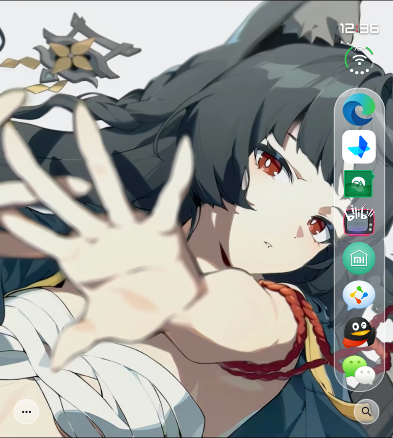
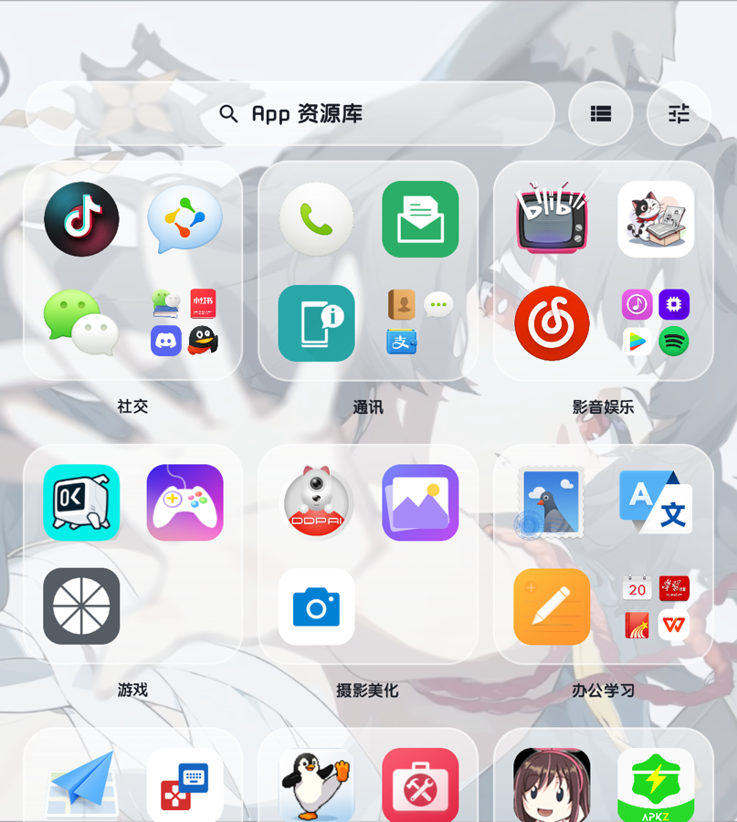
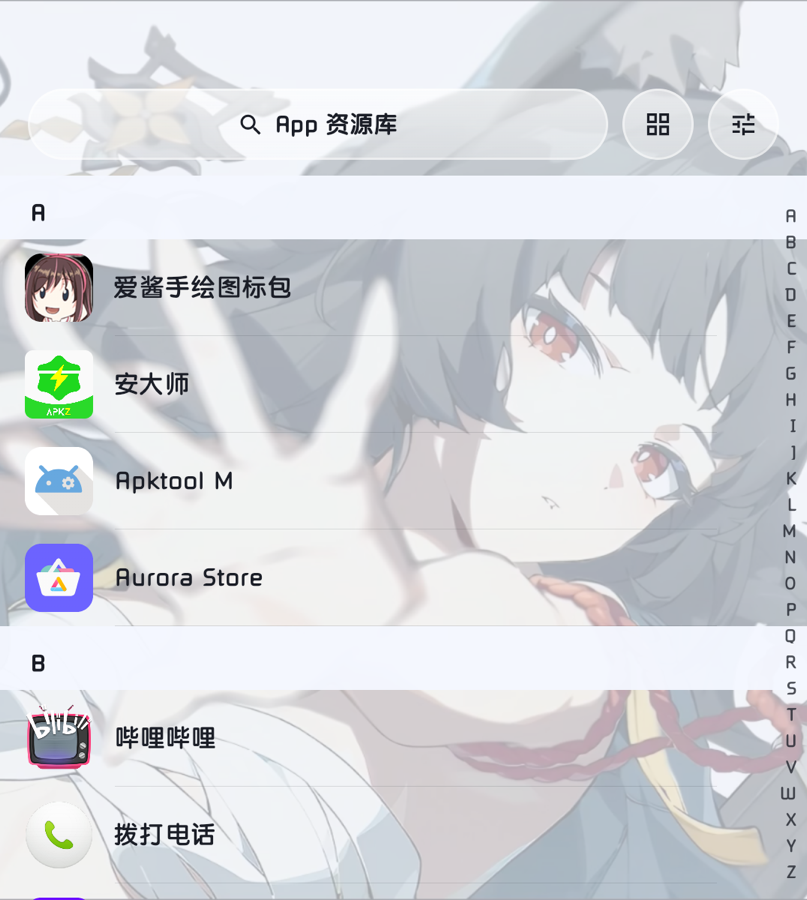
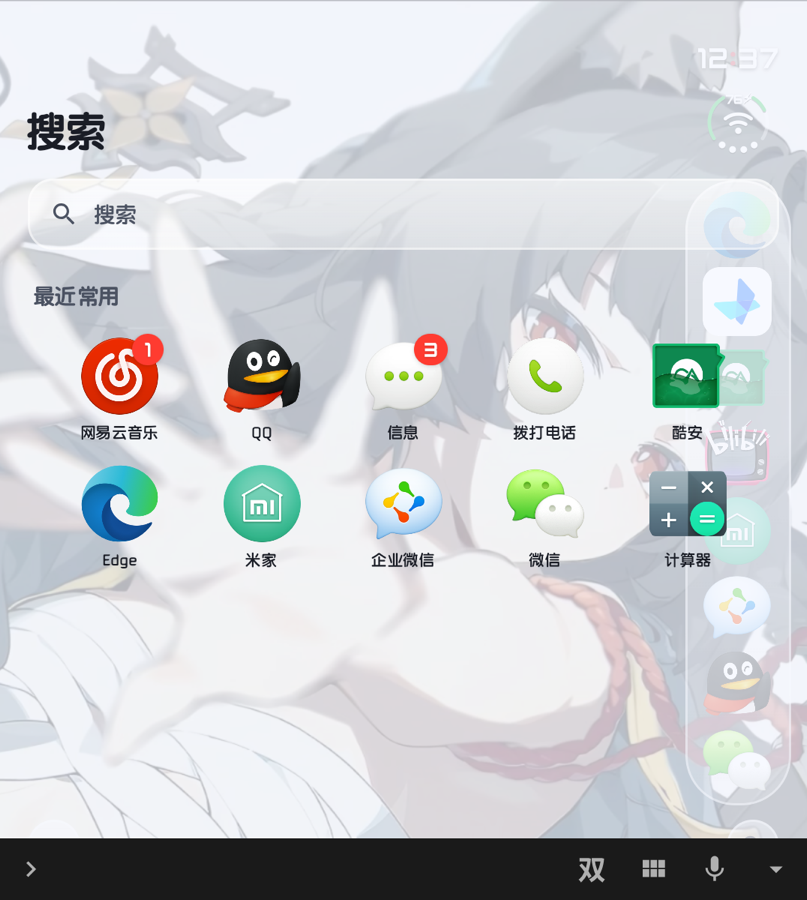
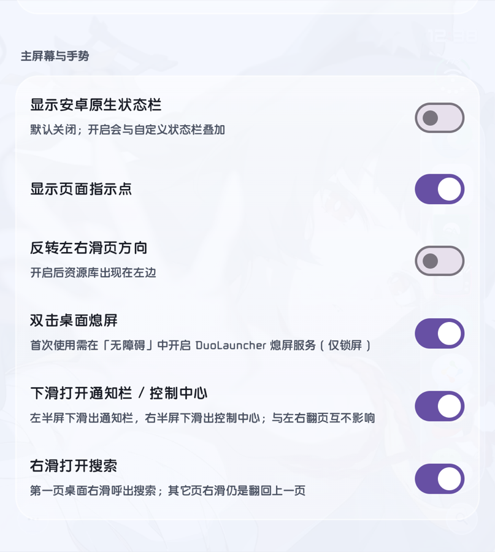
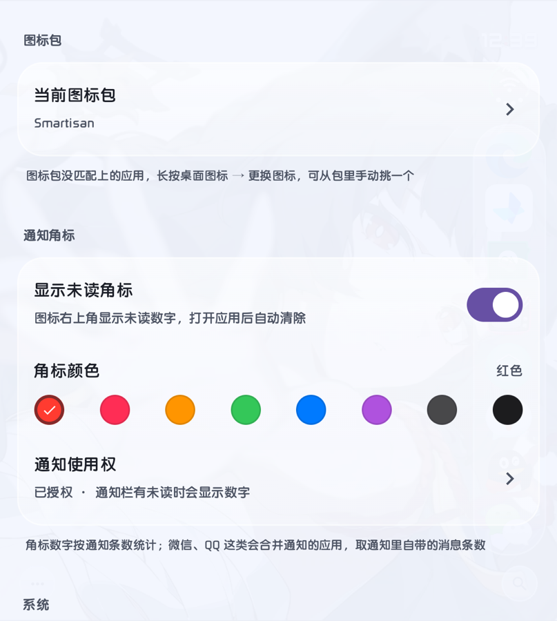
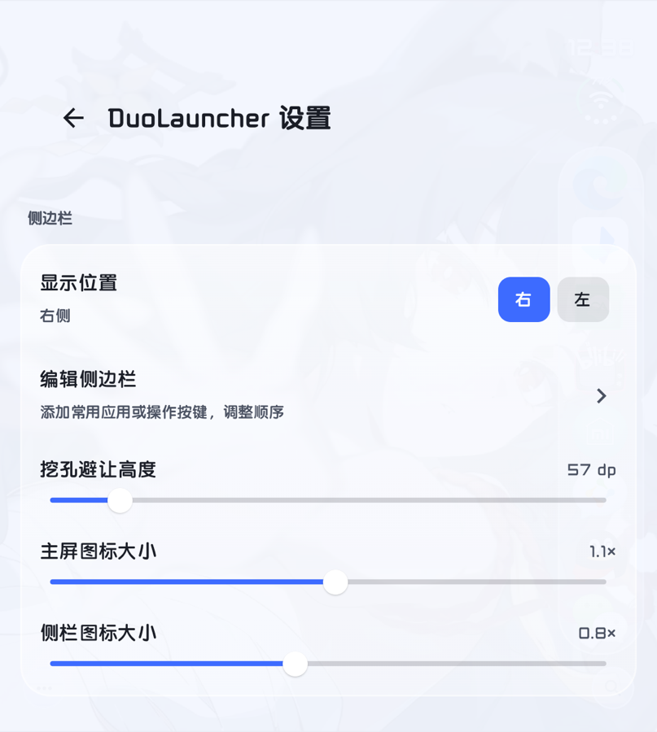
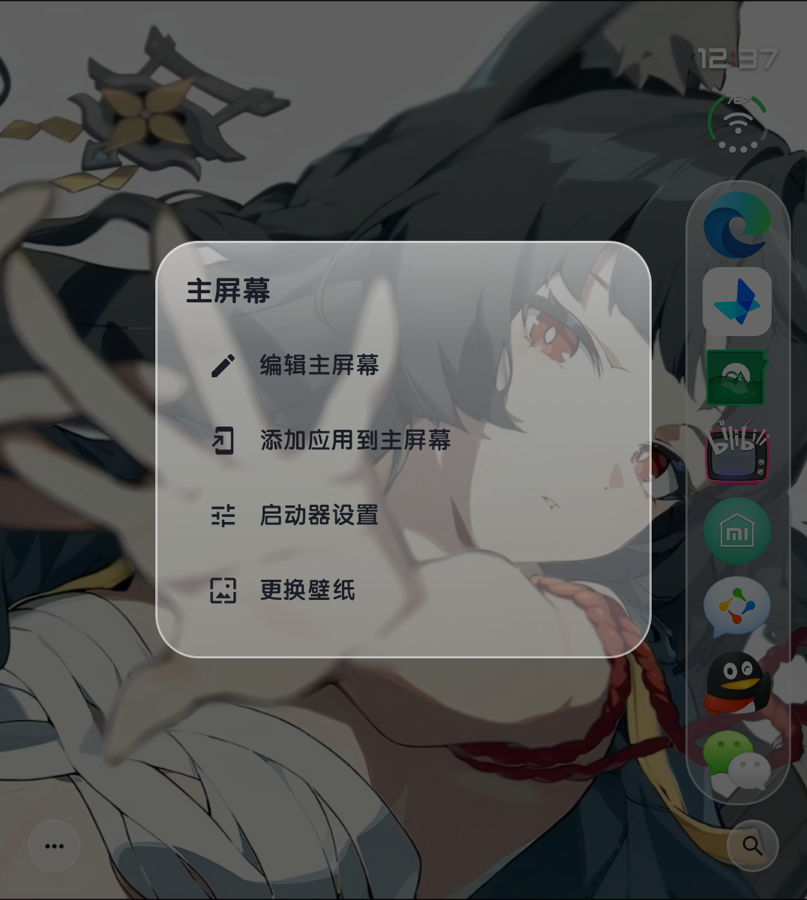

# DuoLauncher

一个用 Kotlin + Jetpack Compose 写的 Android 桌面启动器，iOS 玻璃拟态风格，为 **Unihertz Titan 2 Elite**（1080×1200 近方形屏、左上挖孔、实体键盘）手工适配。

不是主题包，也不是图标包——它就是一个完整的 Launcher（`android.intent.category.HOME`），可以直接设为默认桌面。

[](https://github.com/d3ja7u/DuoLauncher/releases)
[](LICENSE)

<p align="center">
  
  
  
  
</p>

<p align="center">
  
  
  
  
</p>

> 截图均为 Unihertz Titan 2 Elite 实机运行截图（v1.3.8）。

---

## 一、主要特性

| 特性 | 说明 |
|---|---|
| 玻璃拟态外观 | 侧边栏、搜索胶囊、设置卡片都用实时模糊玻璃，模糊强度与深浅可调 |
| iOS 风格状态栏 | 时间 + 弧形信号 + Wi-Fi 点阵，替代安卓原生状态栏；可左右切换、可 24 小时制 |
| 侧边栏 Dock | 屏幕右侧（或左侧）竖排常用应用，可编辑、可排序、图标尺寸单独缩放 |
| App 资源库 | 分类卡视图 + iOS 风格 A–Z 字母列表，右侧字母索引条可点可拖 |
| 通知角标 | 图标右上角未读数字，苹果风格描边气泡，8 种颜色可选 |
| 手势 | 下滑分段呼出通知栏 / 控制中心、右滑呼出搜索、双击熄屏 |
| 图标包 | 支持 Smartisan 等第三方图标包，单个应用也能手动挑图标 |
| 分类管理 | 按应用类型自动归类，也可逐个应用手动指定分类，支持隐藏应用 |

---

## 二、操作说明

### 1. 桌面

- **打开应用**：点图标。
- **翻页**：左右滑动。默认右滑为「回上一页」，最左页再右滑会打开搜索（见手势）。
- **移动 / 排序图标**：长按图标拖到目标位置，桌面会自动让位。
- **编辑主屏幕**：点左下角 `···` → 「编辑主屏幕」，图标进入抖动状态，此时长按图标可调出菜单（换图标 / 应用信息 / 卸载）；再点一次退出编辑。
- **主屏幕菜单**（左下角 `···`）：编辑主屏幕 / 添加应用到主屏幕 / 启动器设置 / 更换壁纸。

### 2. 侧边栏

屏幕右侧竖排的常用应用，点一下直接打开。侧边栏放了多少个图标，行间距会自动收紧，避免压到右下角的搜索按钮。

- 位置：设置 → 侧边栏 → 显示位置（右 / 左）。
- 内容：设置 → 侧边栏 → 编辑侧边栏，可添加应用或操作按键、拖拽调整顺序。
- 尺寸：设置 → 侧边栏 → 侧栏图标大小（与主屏图标分开控制）。
- 长按侧边栏图标：编辑侧边栏 / 从侧边栏移除 / 应用信息。

### 3. App 资源库

在桌面左滑进入（开启「反转左右滑页方向」后出现在左边）。有两种**互斥**视图：

| 视图 | 内容 | 切换方式 |
|---|---|---|
| 分类卡视图 | 3 列玻璃卡，每张卡内是同类应用，带分类名 | 点右上角「列表」图标，或在页面顶部下拉 |
| 字母列表视图 | iOS 风格 A–Z 分组列表，铺满全屏 | 点右上角「四宫格」图标，或在页面顶部下拉 |

- 分类卡视图里点卡片空白处（或第 4 格文件夹位）会弹出该分类的全部应用。
- 列表视图右侧有 A–Z 索引条：**点按或上下拖动**都能直达分组，命中时中间会浮出大字母气泡。索引条只在列表视图出现，只在内容滚过顶部后淡入。
- 下拉切换视图只在**页面已经在顶部**时生效，从列表中段滑回顶部再下拉不会误切。
- 中文应用按**拼音首字母**分组（爱酱 → A，哔哩哔哩 → B），数字和符号归到 `#` 组并排在最后。

### 4. 搜索

三种方式打开：桌面**右滑**、点右下角放大镜、或从最左页右滑。

- 输入即过滤应用名称与包名。
- 未输入时显示「最近常用」两排图标。
- 关闭方式：**左滑**、**上滑**、**返回键**（关闭时会主动收起输入法，不会在桌面底部留下键盘快捷栏）。

### 5. 手势一览

| 手势 | 作用 | 备注 |
|---|---|---|
| 左滑 / 右滑 | 翻页 | 资源库在最右（或最左）一页 |
| **右滑（最左页）** | 打开搜索 | 其它页右滑仍是翻回上一页 |
| **下滑 · 左半屏** | 通知栏 | 累计下滑 ≥ 96dp 触发 |
| **下滑 · 右半屏** | 控制中心（快捷开关） | 起手点在哪半屏就开哪个 |
| **双击桌面空白** | 熄屏 | 需开启无障碍服务 |
| 长按空白 | 主屏幕菜单 | |

> 下滑只接管竖直方向，与左右翻页、图标长按拖拽互不干扰；小幅滑动不会误触发。

### 6. 通知角标

1. 设置 → 通知角标 → 授予「通知使用权」（`NotificationListenerService`）。
2. 打开「显示未读角标」，并选一个角标颜色（红 / 粉 / 橙 / 绿 / 蓝 / 紫 / 石墨 / 黑）。
3. 图标右上角出现数字，点开应用后自动清除。

计数口径：一般应用按通知条数统计；微信、QQ 这类会合并通知的应用，读取通知自带的 `android.number` 数值。

### 7. 应用的右键菜单（长按）

在编辑模式或资源库里长按图标，可以：

- 添加到主屏幕（主屏为空时最常用）
- 更换图标（从当前图标包里手挑一个）
- 应用信息（系统应用详情页）
- 卸载应用

---

## 三、设置项

| 分区 | 设置项 |
|---|---|
| 侧边栏 | 显示位置、编辑侧边栏、挖孔避让高度、主屏图标大小、侧栏图标大小 |
| iOS 风格状态栏 | 显示时间与弧形信号、显示位置、24 小时制、信号点跟随真实强度、距顶部高度、状态栏大小 |
| 主屏幕与手势 | 显示安卓原生状态栏、显示页面指示点、反转左右滑页方向、双击桌面熄屏、下滑打开通知栏 / 控制中心、右滑打开搜索 |
| App 资源库 | 智能分类、调整应用分类、隐藏应用 |
| 外观 | 玻璃模糊强度、深色玻璃 |
| 图标包 | 当前图标包（自动扫描设备上已安装的图标包） |
| 通知角标 | 显示未读角标、角标颜色、通知使用权 |
| 系统 | 设为默认桌面、更换壁纸、DuoLauncher 应用信息、关于 |

入口：桌面左下角 `···` → 启动器设置。

---

## 四、权限说明

| 权限 / 服务 | 用途 | 是否必需 |
|---|---|---|
| 通知使用权 | 读取未读通知条数以显示角标 | 需要角标才开 |
| 无障碍服务（DuoLauncher 熄屏服务） | 双击熄屏；下滑呼出通知栏 / 控制中心的备用通道 | 需要熄屏才开 |
| `EXPAND_STATUS_BAR` | 展开通知栏 / 快捷开关面板 | 普通权限，安装即授予 |
| `QUERY_ALL_PACKAGES` | 列出并启动已安装应用 | 必需 |
| `REQUEST_DELETE_PACKAGES` | 卸载应用 | 可选 |
| `BIND_APPWIDGET` | 承载桌面小组件 | 可选 |

本应用**不上传任何数据**，没有远程服务端，所有布局与偏好仅保存在本机 `SharedPreferences`。

---

## 五、构建

环境要求：

- JDK 17
- Android SDK Platform 34（`compileSdk = 34`）
- Gradle 8.9（随 wrapper 提供）

```bash
git clone https://github.com/d3ja7u/DuoLauncher.git
cd DuoLauncher

# 指向本机 Android SDK（该文件不入库）
echo "sdk.dir=$HOME/Library/Android/sdk" > local.properties

./gradlew assembleDebug
# 产物：app/build/outputs/apk/debug/app-debug.apk
```

也可以直接用 Android Studio（Koala 及以上）打开根目录。

**依赖镜像**：`settings.gradle.kts` 里预置了阿里云镜像（国内构建更快）。若在海外构建卡住，把 `maven { url = uri("https://maven.aliyun.com/...") }` 几行去掉，保留 `google()` / `mavenCentral()` 即可。

版本矩阵：

| 组件 | 版本 |
|---|---|
| AGP | 8.5.2 |
| Kotlin | 1.9.24 |
| Compose BOM | 2024.06.00 |
| Gradle | 8.9 |
| compileSdk / targetSdk | 34 |
| minSdk | 28（Android 9） |

---

## 六、已知限制

- **为方屏适配**：布局尺寸、状态栏位置、挖孔避让都是按 1080×1200 / density 331 调的。换到普通 20:9 手机上能跑，但玻璃卡片留白、网格密度需要自行调 `DuoState` 里的默认值。
- **字母分组依赖拼音**：用 `Transliterator("Han-Latin")` 取汉字首字母，多音字按 ICU 默认读音，个别人名/品牌名可能归错组。
- **控制中心是一次到位展开**：Android 16 起 `expandSettingsPanel()` 直接展开磁贴面板，没有「先露通知再拉全」的中间态。想看通知请用左半屏。
- **小组件宿主**：`AppWidgetHost` 已实现，但添加入口目前挂在未启用的今日页上，日常使用暂时用不到。
- 状态栏的信号格数来自 `TelephonyManager` / `WifiManager` 的强度分级，个别 ROM 上可能显示为满格。

---

## 七、版本记录

| 版本 | 变更 |
|---|---|
| 1.3.8 | 设置「关于」的版本号改为从包信息动态读取 |
| 1.3.7 | 搜索框占位文字精简为「搜索」 |
| 1.3.6 | 去掉搜索页右上角关闭按钮，保留左滑 / 上滑 / 返回键关闭 |
| 1.3.5 | 搜索页支持左滑关闭，移除底部提示文案 |
| 1.3.4 | 桌面右滑打开搜索（仅最左页接管） |
| 1.3.3 | 下滑手势：左半屏通知栏、右半屏控制中心 |
| 1.3.2 | 移除下滑搜索；修复退出搜索后键盘快捷栏残留 |
| 1.3.1 | 资源库拆成「分类卡 / 字母列表」两个互斥视图，索引条加宽；修正字母分组顺序 |
| 1.3.0 | 资源库新增 iOS 风格 A–Z 字母列表与索引条 |
| 1.2.x | 玻璃外观调校、通知角标、状态栏位置、去除负一屏 |

---

## 八、下载与发行版

**不想自己编译**：直接到 [Releases](https://github.com/d3ja7u/DuoLauncher/releases) 下载最新一版的 `DuoLauncher-x.y.z.apk` 安装。

发版流程：每完成一版，改 `versionName` / `versionCode` → `./gradlew assembleDebug` → 打 tag（如 `v1.3.9`）→ 在 Releases 里附带该 APK。

仓库里也备好了一份 GitHub Actions 工作流（`.github/workflows/release.yml`）：推一个形如 `v1.3.9` 的 tag，CI 就会自动编译、生成变更说明并发布 Release。启用它需要把仓库的 Actions 打开（仓库 Settings → Actions → Allow all actions）；工作流文件本身需要带 `workflow` 权限的凭据才能推送。

```bash
git tag v1.3.9
git push origin v1.3.9
```

签名说明：发行包使用调试签名构建，与本地 `./gradlew assembleDebug` 产出的包签名不同，若手机上已有旧包会提示签名不一致，卸载后重装即可。想让它与本地包同签名，可在仓库 Secrets 里加一个 `DEBUG_KEYSTORE_B64`（本机 `~/.android/debug.keystore` 的 base64），工作流会自动使用。

---

## 九、许可

[MIT](LICENSE) © 2026 d3ja7u

---

## 十、说明

个人自用项目，按自己的使用习惯长出来的，代码结构以「能改得动」为先，没有做多机型适配与单元测试。欢迎提 Issue 交流思路。
