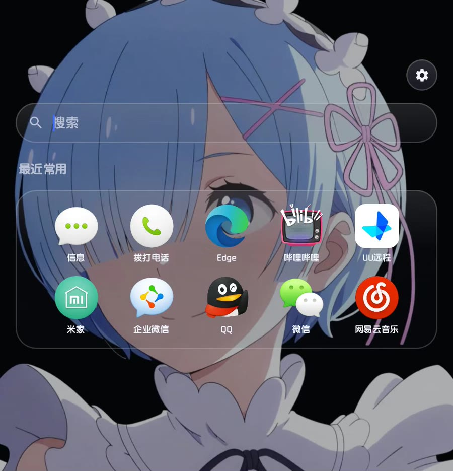
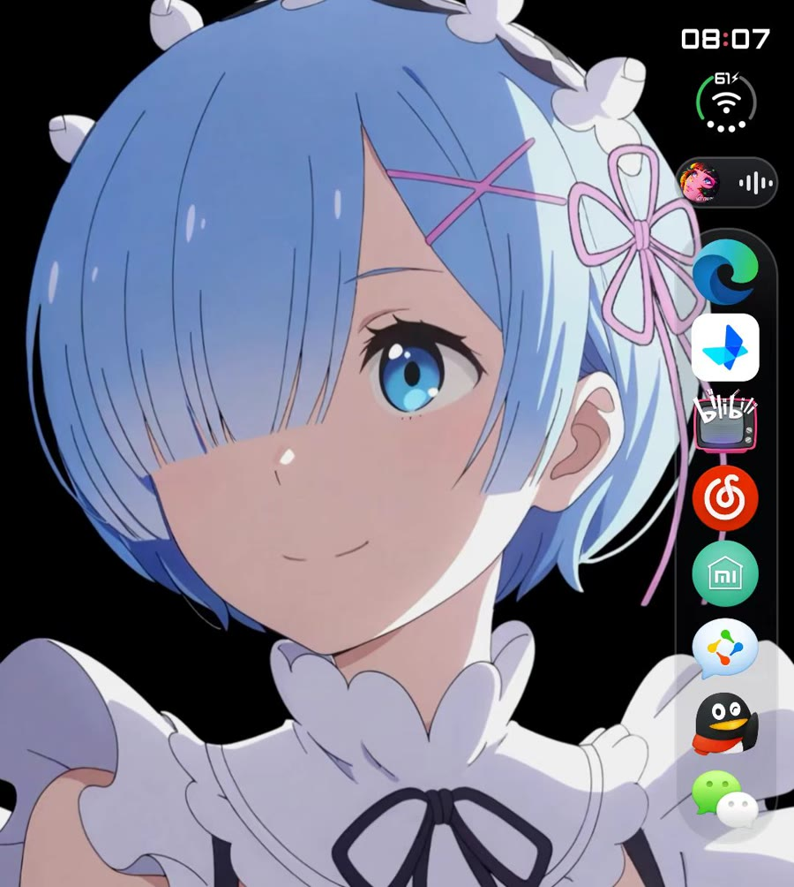
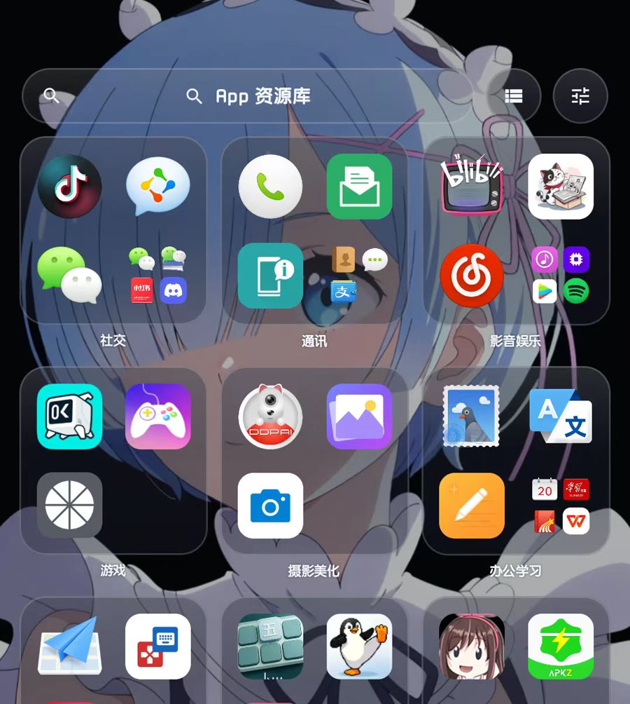
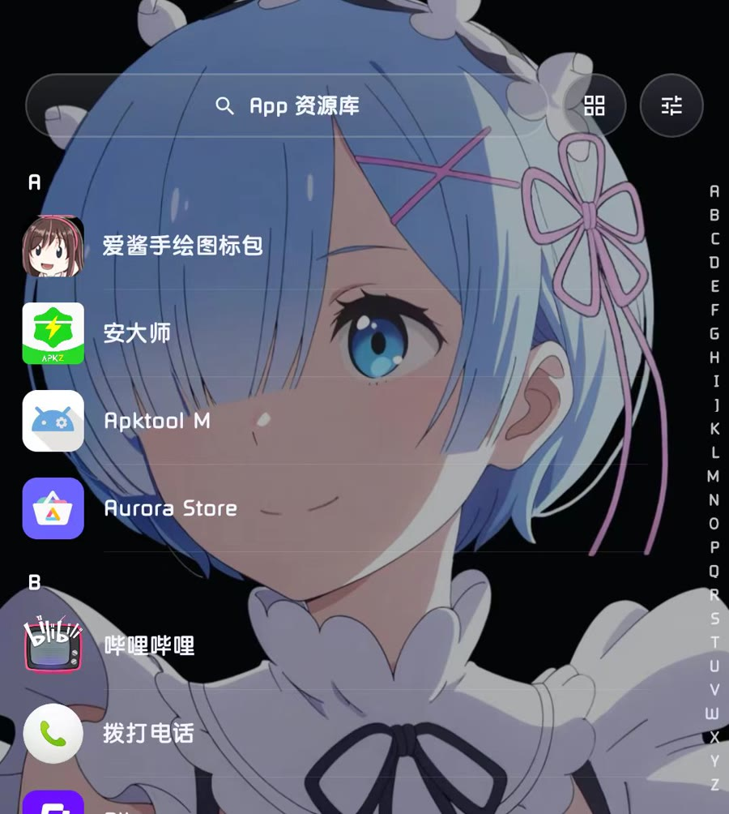
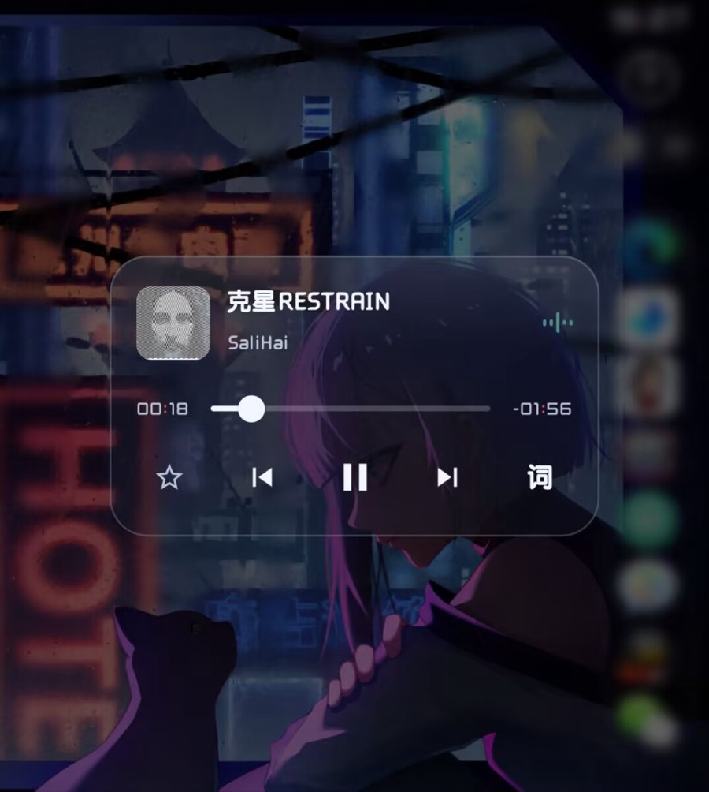
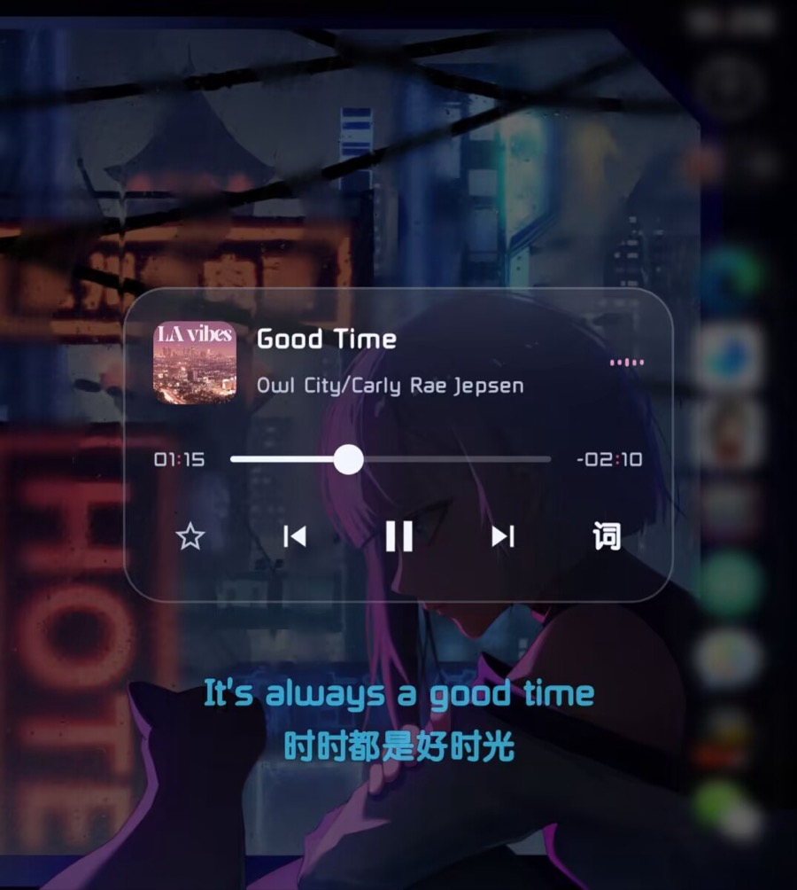
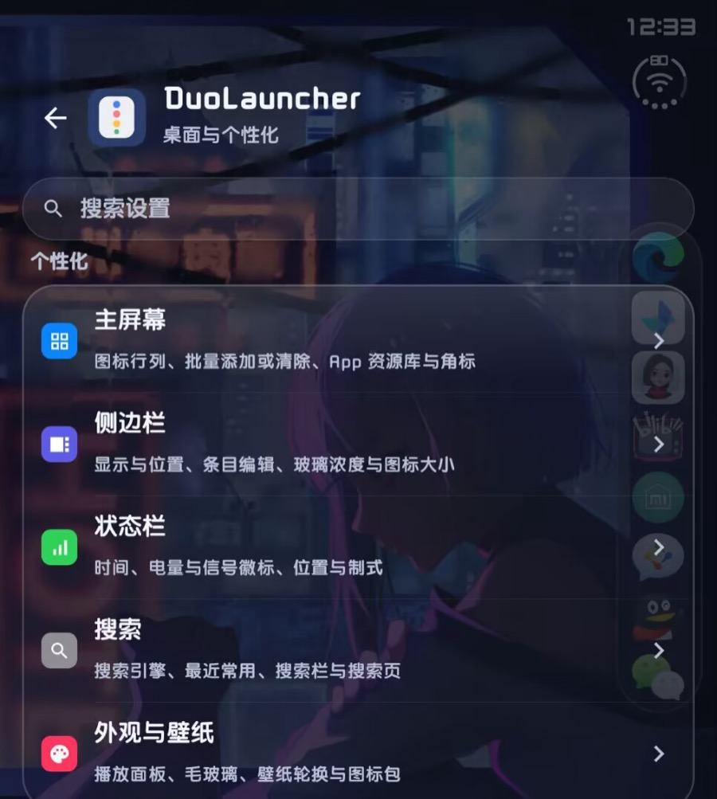
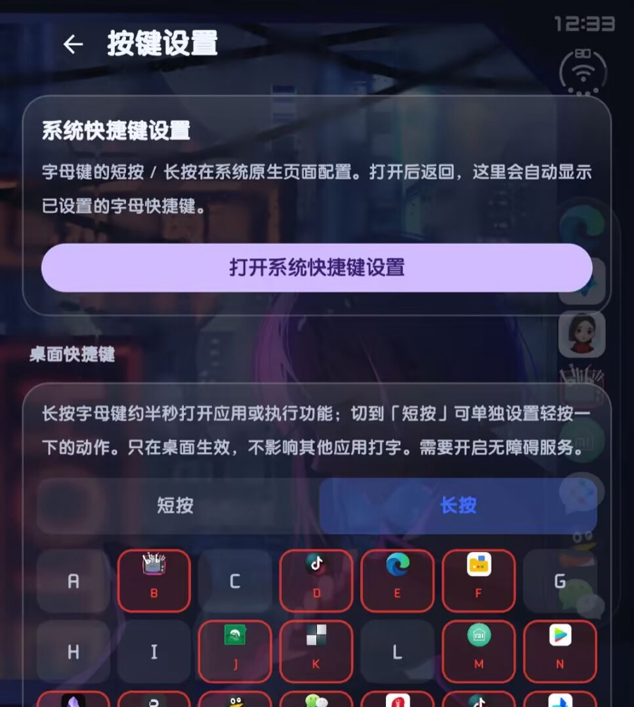

# DuoLauncher

**简体中文** | [English](README.en.md)

一个用 Kotlin + Jetpack Compose 写的 Android 桌面启动器，iOS 玻璃拟态风格，为 **Unihertz Titan 2 Elite**（1080×1200 近方形屏、左上挖孔、实体键盘）手工适配。

不是主题包，也不是图标包——它就是一个完整的 Launcher（`android.intent.category.HOME`），可以直接设为默认桌面。

[](https://github.com/d3ja7u/DuoLauncher/releases/latest)
[](https://gitee.com/d3ja7u/DuoLauncher/releases/latest)
[](LICENSE)

<p align="center">
  
  
  
  
  
  
  
  
</p>

> 截图均为 Unihertz Titan 2 Elite 实机运行截图（v1.7.1），展示的是中文界面；界面语言会跟随设备，也可在「设置 → 系统 → 语言」里手动切换。

---

## 一、主要特性

| 特性 | 说明 |
|---|---|
| 玻璃拟态外观 | 侧边栏、搜索胶囊、设置卡片都用实时模糊玻璃，模糊强度与深浅可调 |
| iOS 风格状态栏 | 时间 + 弧形信号 + Wi-Fi 点阵，替代安卓原生状态栏；可左右切换、可 24 小时制 |
| 侧边栏 Dock | 屏幕右侧（或左侧）竖排常用应用，可编辑、可排序、图标尺寸单独缩放 |
| 音乐胶囊 | 侧栏上方显示正在播放的音乐：圆形封面 + 律动频谱（颜色跟随封面）。点一下展开播放面板，长按暂停 / 继续：点封面或歌名打开播放器、收藏、可拖动进度条、上一首 / 暂停 / 下一首，音乐支持时还可开关歌词显示；暂停后胶囊仍保留。面板固定宽度、弹出时背景虚化、点空白处关闭，位置可在「设置 → 音乐胶囊」里选靠顶 / 居中 / 靠底，默认居中 |
| App 资源库 | 分类卡视图 + iOS 风格 A–Z 字母列表，右侧字母索引条可点可拖 |
| 全局搜索 | 应用 + 通讯录联系人 + 网页搜索三合一；回车直达首个结果，网页用系统默认浏览器打开 |
| 通知角标 | 图标右上角未读数字，苹果风格描边气泡，8 种颜色可选 |
| 手势 | 下滑分段呼出通知栏 / 控制中心、右滑呼出搜索、双击息屏 |
| 图标包 | 支持 Smartisan 等第三方图标包，单个应用也能手动挑图标 |
| 分类管理 | 按应用类型自动归类，也可逐个应用手动指定分类，支持隐藏应用 |
| 多语言界面 | 简体中文 / English / 日本語，默认跟随设备语言，设置里可手动指定 |
| 空桌面起步 | 新安装默认主屏不放任何应用图标，桌面完全由自己布置 |
| 设置备份 | 一键导出 / 导入 JSON，覆盖主屏布局、侧栏、文件夹、分类、图标、语言等全部设置 |
| 长按打开主屏菜单 | 长按主屏空白处弹出菜单：编辑主屏幕 / 添加应用 / 添加系统小组件 / 启动器设置 / 更换壁纸 |
| 底部无图标 | 主屏底部不再有设置 / 搜索图标；设置走长按空白，搜索走最左页右滑或侧栏动作 |

---

## 二、操作说明

### 1. 桌面

- **新安装默认是空主屏**：桌面网格不放任何应用图标（右侧仍保留一排默认侧边栏）。想放图标，长按主屏空白处 → **添加应用到主屏幕**，或在 App 资源库里长按应用后选「添加到主屏幕」。已有配置升级后不会被清空。
- **打开应用**：点图标。
- **翻页**：左右滑动。默认右滑为「回上一页」，最左页再右滑会打开搜索（见手势）。
- **移动 / 排序图标**：长按图标拖到目标位置，桌面会自动让位。
- **编辑主屏幕**：长按主屏空白处 → 「编辑主屏幕」，图标抖动且左上角出现 iOS 风格 `-`。点 `-` 弹出「从主屏幕移除 / 卸载应用 / 取消」——「从主屏幕移除」只把图标收回 App 资源库，**不会卸载应用**。长按图标仍可调出更多菜单（换图标 / 应用信息 / 卸载）。再次长按空白处，在菜单里点「完成编辑」退出。
- **主屏幕菜单**（长按主屏空白处）：编辑主屏幕 / 添加应用到主屏幕 / 添加系统小组件 / 启动器设置 / 更换壁纸。
- **底部没有常驻图标**：主屏底部只剩页面指示点；设置从上面的菜单进入，搜索走最左页右滑，也可在侧栏动作里添加「搜索」按钮直接打开。

### 2. 侧边栏

屏幕右侧竖排的常用应用，点一下直接打开。侧边栏放了多少个图标，行间距会自动收紧，避免与主屏图标挤在一起。

- 显示 / 隐藏：设置 → 侧边栏 → **显示侧边栏**。关掉后主屏图标不再为侧栏留白，顶部状态指示器仍保留。
- 位置：设置 → 侧边栏 → 显示位置（右 / 左）。
- 内容：设置 → 侧边栏 → 编辑侧边栏，可添加应用或操作按键、拖拽调整顺序。
- 尺寸：设置 → 侧边栏 → 侧栏图标大小（与主屏图标分开控制）。
- 长按侧边栏图标：编辑侧边栏 / 从侧边栏移除 / 应用信息。

### 3. App 资源库

在桌面左滑进入（开启「反转左右滑页方向」后出现在左边）。有两种**互斥**视图：

| 视图 | 内容 | 切换方式 |
|---|---|---|
| 分类卡视图 | 3 列玻璃卡，每张卡内是同类应用，带分类名 | 点右上角「列表」图标，或在页面顶部下拉 |
| 字母列表视图 | iOS 风格 A–Z 分组列表，铺满全屏 | 点右上角「四宫格」图标，或在页面顶部下拉 |

- 分类卡视图里点卡片空白处（或第 4 格文件夹位）会弹出该分类的全部应用。
- 列表视图右侧有 A–Z 索引条：**点按或上下拖动**都能直达分组，命中时中间会浮出大字母气泡。索引条只在列表视图出现，只在内容滚过顶部后淡入。
- 下拉切换视图只在**页面已经在顶部**时生效，从列表中段滑回顶部再下拉不会误切。
- 中文应用按**拼音首字母**分组（爱酱 → A，哔哩哔哩 → B），数字和符号归到 `#` 组并排在最后。

### 4. 搜索

两种方式打开：在主屏（最左页）**右滑**，或在侧栏动作里添加「搜索」后点按。设置 → 主屏幕与手势可关掉右滑手势。

- **应用**：输入即按名称 / 包名过滤；未输入时显示「最近常用」，数量可选 0 / 5 / 10 / 15 / 20 个（选 0 即不显示）。
- **联系人**：按姓名、号码匹配通讯录（首次使用会申请「读取通讯录」权限）。点条目打开联系人详情，点右侧电话图标直接拨号。
- **网页搜索**：结果底部一条「使用 百度 / 必应 / 谷歌 搜索」。点它、或在没有应用 / 联系人命中时直接回车，都用**系统默认浏览器**打开，应用内不嵌网页。
- **回车直达**：键盘按搜索 / 回车，按顺序打开第一个结果（应用 → 联系人 → 网页搜索）。
- **搜索设置**：搜索页右上角齿轮，或设置 → 搜索，可改最近常用数量、搜索引擎、是否搜索联系人；显示搜索栏、显示搜索页面在设置 → 搜索里，两处状态同步。
- 关闭方式：**左滑**、**上滑**、**返回键**（关闭时会主动收起输入法，不会在桌面底部留下键盘快捷栏）。

### 5. 手势一览

| 手势 | 作用 | 备注 |
|---|---|---|
| 左滑 / 右滑 | 翻页 | 资源库在最右（或最左）一页 |
| **右滑（最左页）** | 打开搜索 | 其它页右滑仍是翻回上一页 |
| **下滑 · 左半屏** | 通知栏 | 累计下滑 ≥ 96dp 触发 |
| **下滑 · 右半屏** | 控制中心（快捷开关） | 起手点在哪半屏就开哪个 |
| **双击桌面空白** | 息屏 | 需开启无障碍服务 |
| **长按空白** | 打开主屏菜单 | 编辑 / 添加应用 / 添加小组件 / 设置 / 壁纸都在这里 |

> 下滑只接管竖直方向，与左右翻页、图标长按拖拽互不干扰；小幅滑动不会误触发。

### 6. 通知角标

1. 设置 → 通知角标 → 授予「通知使用权」（`NotificationListenerService`）。
2. 打开「显示未读角标」，并选一个角标颜色（红 / 粉 / 橙 / 绿 / 蓝 / 紫 / 石墨 / 黑）。
3. 图标右上角出现数字，点开应用后自动清除。

计数口径：一般应用按通知条数统计；微信、QQ 这类会合并通知的应用，读取通知自带的 `android.number` 数值。

### 7. 应用的右键菜单（长按）

在编辑模式或资源库里长按图标，可以：

- 添加到主屏幕（主屏为空时最常用）
- 更换图标（从当前图标包里手挑一个）
- 应用信息（系统应用详情页）
- 卸载应用

---

## 三、设置项

| 分区 | 设置项 |
|---|---|
| 侧边栏 | 显示侧边栏、显示位置、编辑侧边栏、挖孔避让高度、主屏图标大小、侧栏图标大小 |
| 搜索 | 最近常用数量（0 / 5 / 10 / 15 / 20，0 为不显示）、搜索引擎（百度 / 必应 / 谷歌）、搜索联系人、显示搜索栏、显示搜索页面 |
| iOS 风格状态栏 | 显示时间与弧形信号、显示位置、24 小时制、信号点跟随真实强度、距顶部高度、状态栏大小 |
| 主屏幕与手势 | 显示安卓原生状态栏、显示页面指示点、反转左右滑页方向、双击桌面息屏、下滑打开通知栏 / 控制中心、右滑打开搜索 |
| App 资源库 | 智能分类、调整应用分类、隐藏应用 |
| 外观 | 玻璃模糊强度、深色玻璃 |
| 图标包 | 当前图标包（自动扫描设备上已安装的图标包） |
| 通知角标 | 显示未读角标、角标颜色、通知使用权 |
| 更新 | 检查更新、在线下载安装、自动检查更新、更新源、打开项目主页 |
| 隐私与统计 | 匿名使用统计开关、本机匿名 ID、查看统计数据 |
| 备份与恢复 | 导出设置、导入设置 |
| 系统 | 语言、设为默认桌面、更换壁纸、DuoLauncher 应用信息、关于 |

入口：长按主屏空白处 → 启动器设置。

### 多语言

内置**简体中文 / English / 日本語**三套界面文案。

- 默认**跟随设备语言**：系统语言（含 Android 13+ 的「按应用设定语言」）为英文或日文时自动切换，其它语言回退中文。
- 手动指定：设置 → 系统 → **语言** → 跟随系统 / 简体中文 / English / 日本語。选择后立即生效，且切换完仍停留在设置页，方便对照。
- 选择保存在本机，重启后依然有效；手动选择优先于系统语言，选「跟随系统」即交还给系统。
- 应用分类名、快捷动作名、日期与星期都会跟随语言；你自己起的文件夹名、便签等内容不会被翻译。

译文在 `app/src/main/res/values/`、`values-en/`、`values-ja/`；`util/Lang.kt` 负责语言切换，并提供 `Lang.s()` 供非 Composable 代码取文案。

### 设置备份与恢复

设置 → **备份与恢复**：

- **导出设置**：弹出系统「保存文件」对话框，默认名 `DuoLauncher-backup-年月日-时分.json`，保存位置由你自己选（本机、网盘、发给另一台设备都可以）。
- **导入设置**：选一份之前导出的 JSON，先弹出摘要（导出时间、版本、主屏 / 侧栏 / 文件夹 / 隐藏应用 / 小组件数量）供核对，确认后才覆盖当前配置并自动重启启动器。

备份是整份本地配置：主屏布局与排序、侧边栏、文件夹、隐藏应用、分类与单个应用的图标覆盖、图标包、外观与手势、角标设置、搜索设置、界面语言、更新源与更新检查记录。**不包含**匿名统计 ID（单独存放，导入别人的备份不会串号）、通知角标已读状态、壁纸图片、应用数据、通讯录和账号。文件只写到你选择的位置，不会自动上传，导入时也不会读取别处的数据。

导入是**整体覆盖**、不能只挑某一项，建议先导出一份当前设置留底。跨设备恢复时，备份里引用了本机未安装应用的图标会被自动忽略，其余布局保持不变。

---

## 四、权限说明

| 权限 / 服务 | 用途 | 是否必需 |
|---|---|---|
| 通知使用权 | 读取未读通知条数以显示角标 | 需要角标才开 |
| 无障碍服务（DuoLauncher 息屏服务） | 双击息屏；下滑呼出通知栏 / 控制中心的备用通道 | 需要息屏才开 |
| `EXPAND_STATUS_BAR` | 展开通知栏 / 快捷开关面板 | 普通权限，安装即授予 |
| `QUERY_ALL_PACKAGES` | 列出并启动已安装应用 | 必需 |
| `READ_CONTACTS` | 在搜索结果里匹配通讯录联系人 | 可选，按需申请 |
| `REQUEST_DELETE_PACKAGES` | 卸载应用 | 可选 |
| `REQUEST_INSTALL_PACKAGES` | 在线更新时调起系统安装器（需用户在系统设置里允许「安装未知来源应用」） | 可选，仅手动点「下载并安装」时用到 |
| `INTERNET` | 检查更新、在线下载安装、可选的匿名使用统计 | 可选，关掉这两项后不产生业务请求 |
| `BIND_APPWIDGET` | 承载桌面小组件 | 可选 |

布局与偏好只保存在本机 `SharedPreferences`，应用没有账号、不读取也不上传个人内容。**唯一可能离开设备的数据是可关闭的匿名使用统计**（随机匿名 ID + 版本 + 界面语言 + Android API 等级 + 设备机型名 + 上报类型）：首次启动会先询问一次，设置 → 隐私与统计 可随时关闭，关闭即删除本机匿名 ID。机型仅取通用型号名（如 Titan 2 Elite），不含序列号 / IMEI / Android ID 等唯一标识。详见 [PRIVACY.md](PRIVACY.md)。

---

## 五、构建

环境要求：

- JDK 17
- Android SDK Platform 34（`compileSdk = 34`）
- Gradle 8.9（随 wrapper 提供）

```bash
git clone https://gitee.com/d3ja7u/DuoLauncher.git   # 国内推荐
# 或：git clone https://github.com/d3ja7u/DuoLauncher.git
cd DuoLauncher

# 指向本机 Android SDK（该文件不入库）
echo "sdk.dir=$HOME/Library/Android/sdk" > local.properties

./gradlew assembleDebug
# 产物：app/build/outputs/apk/debug/app-debug.apk

# 正式发行包（release 变体：开启 R8 与资源缩减，约 2.1 MB、非 debuggable）
./gradlew assembleRelease
# 产物：app/build/outputs/apk/release/app-release.apk
```

也可以直接用 Android Studio（Koala 及以上）打开根目录。

**依赖镜像**：`settings.gradle.kts` 里预置了阿里云镜像（国内构建更快）。若在海外构建卡住，把 `maven { url = uri("https://maven.aliyun.com/...") }` 几行去掉，保留 `google()` / `mavenCentral()` 即可。

版本矩阵：

| 组件 | 版本 |
|---|---|
| AGP | 8.5.2 |
| Kotlin | 1.9.24 |
| Compose BOM | 2024.06.00 |
| Gradle | 8.9 |
| compileSdk / targetSdk | 34 |
| minSdk | 28（Android 9） |

---

## 六、已知限制

- **为方屏适配**：布局尺寸、状态栏位置、挖孔避让都是按 1080×1200 / density 331 调的。换到普通 20:9 手机上能跑，但玻璃卡片留白、网格密度需要自行调 `DuoState` 里的默认值。
- **字母分组依赖拼音**：用 `Transliterator("Han-Latin")` 取汉字首字母，多音字按 ICU 默认读音，个别人名/品牌名可能归错组。
- **控制中心是一次到位展开**：Android 16 起 `expandSettingsPanel()` 直接展开磁贴面板，没有「先露通知再拉全」的中间态。想看通知请用左半屏。
- **小组件宿主**：`AppWidgetHost` 已实现，但添加入口目前挂在未启用的今日页上，日常使用暂时用不到。
- 状态栏的信号格数来自 `TelephonyManager` / `WifiManager` 的强度分级，个别 ROM 上可能显示为满格。

---

## 七、版本记录

| 版本 | 变更 |
|---|---|
| 1.7.2 | 长按桌面小组件可选择「调整大小」，按列数、行数自定义组件尺寸；设置 → 侧边栏新增「侧栏图标间距」；修复关闭「显示搜索页面」后主屏首页空白、新添加的小组件显示在第二页、左右滑动回不到首页的问题；修复小组件移动到其他主屏页面后不显示的问题；修复部分全键盘设备「按键设置」无法正常显示的问题 |
| 1.7.1 | 修复使用字母快捷键打开应用后输入框仍继续输入字母的问题；修复部分设备使用触摸板左右滑动切换桌面时页面停在两页之间的问题；字母键已被系统快捷键占用时以橙色标记提示，并可直接前往系统设置清除；适配安卓 17，优化桌面图标与小组件移动、图标加载与翻页流畅度，降低功耗 |
| 1.7.0 | 新增桌面快捷键：为字母键指定应用或功能，短按与长按可分别设置，系统已配置的字母快捷键自动显示并可直达系统设置；新增「锁定布局」；检查更新可选 Gitee 或 GitHub 服务器并可设置检查间隔，发现新版本时桌面底部显示提示，点击即可查看说明并下载安装；设置界面按分类整理并适配平板等大屏；优化图标与小组件的移动体验、图标加载与翻页流畅度，降低功耗；适配安卓 17 |
| 1.6.1 | 音乐胶囊点击展开播放面板，支持进度拖动、收藏、上一首 / 下一首与歌词入口，长按暂停或继续；面板位置可选靠顶、居中、靠底；状态栏时间与三合一状态可分别关闭；搜索页支持单独关闭搜索栏或整个页面，最近常用数量可选 0（不显示）；优化音乐胶囊频谱显示与专辑封面的加载切换 |
| 1.6.0 | 主屏幕长按空白可添加应用或系统小组件，图标与小组件可自由摆放、拖进文件夹、拖到屏幕边缘移到相邻一屏；设置 → 分类管理支持新建/重命名/删除分类并可恢复；设置中可隐藏 App 资源库；优化平板等大屏设备的显示效果 |
| 1.5.16 | 设置 → 双击桌面息屏新增「备用息屏方式」，可选无障碍模式与设备管理员两种方案；优化深色壁纸下桌面时间与三合一状态图标黑白自动切换的判断逻辑；修复备用息屏方式无法开启、已启用备用方式时仍跳转无障碍授权的问题 |
| 1.5.15 | 进一步优化功耗，全面优化应用性能 |
| 1.5.14 | 设置 → 壁纸新增「同步锁屏壁纸」开关，开启后锁屏与主屏壁纸同步切换；优化主屏幕滑动体验，降低功耗 |
| 1.5.13 | 设置新增「壁纸自动切换」（相册多选、按间隔更换、上滑切换）与三合一「显示电量数字」开关；三合一图标随耳机、个人热点、省电模式、充电状态及壁纸明暗自动变化；优化壁纸显示与网络制式显示 |
| 1.5.12 | 双卡状态下三合一图标改为 Duo 风格双排信号点（上排卡 1、下排卡 2），单卡仍为原样式；设置新增「网络制式显示」5G / LTE 切换；优化双击息屏的无障碍授权状态 |
| 1.5.11 | 搜索页改为原生分页，切换更顺滑；设置 → 主屏幕新增桌面图标「批量添加」「批量清除」（清除有二次确认）与「新装应用自动加到桌面」开关；修复 5 列以上空白第二页、5G 信号格不一致、「靠下居中」位置 |
| 1.5.10 | 修复搜索页 / 资源库返回主屏后输入法工具栏残留与闪动，搜索框改用系统原生控件；状态徽标的 WiFi 圆点与移动信号按真实强度显示；修复资源库搜索偶发无法输入 |
| 1.5.9 | 新增音乐胶囊（封面 + 频谱、轻点打开播放器、长按暂停）与设置开关；主屏新增图标列数 / 行数、侧栏垂直对齐与玻璃浓度；磨砂背景重做，UI 效果大量优化 |
| 1.5.8 | 修复克隆空间 / 多用户应用（如微信分身）无法正常显示与搜索的问题 |
| 1.5.6 | 新增可关闭的匿名使用统计：首次启动询问、设置开关 / 上报地址 / 查看统计、关闭即删除匿名 ID；自带零依赖统计服务端脚本；隐私政策三语同步改写 |
| 1.5.5 | 检查更新支持在线下载并直接安装：下载进度、取消、安装权限引导、私有缓存 + FileProvider、失败回退下载页；订阅源也能拼出 APK 直链 |
| 1.5.4 | 应用、文档与发版说明术语统一：「熄屏」改为「息屏」 |
| 1.5.3 | 长按主屏空白可直接进入启动器设置；左下角设置图标、右下角搜索图标支持在设置中隐藏，隐藏后仍可用长按 / 手势进入 |
| 1.5.2 | 搜索新增联系人 / 网页 / 最近常用，回车直达首个结果；编辑主屏改用 iOS 风格减号；新装默认空主屏；设置支持 JSON 备份与导入 |
| 1.5.1 | 搜索页改为跟手滑入 / 滑出；修复通知角标（排除常驻通知、已读状态持久化）；改用 release 构建，APK 从 52 MB 降至约 2 MB |
| 1.5.0 | 多语言界面：简体中文 / English / 日本語，默认跟随设备语言，设置里可手动指定；新增英文版 README |
| 1.4.1 | 更新源编辑弹窗改为实底、长地址折行显示；保存时自动去掉空白字符 |
| 1.4.0 | 设置新增「更新」分组：可配置 GitHub Releases 更新源、手动/自动检查更新、失败自动回退官方订阅源 |
| 1.3.9 | 发版自动化：打 tag 即由 Actions 编译并发布 Release，CI 包与本机同签名可覆盖安装 |
| 1.3.8 | 设置「关于」的版本号改为从包信息动态读取 |
| 1.3.7 | 搜索框占位文字精简为「搜索」 |
| 1.3.6 | 去掉搜索页右上角关闭按钮，保留左滑 / 上滑 / 返回键关闭 |
| 1.3.5 | 搜索页支持左滑关闭，移除底部提示文案 |
| 1.3.4 | 桌面右滑打开搜索（仅最左页接管） |
| 1.3.3 | 下滑手势：左半屏通知栏、右半屏控制中心 |
| 1.3.2 | 移除下滑搜索；修复退出搜索后键盘快捷栏残留 |
| 1.3.1 | 资源库拆成「分类卡 / 字母列表」两个互斥视图，索引条加宽；修正字母分组顺序 |
| 1.3.0 | 资源库新增 iOS 风格 A–Z 字母列表与索引条 |
| 1.2.x | 玻璃外观调校、通知角标、状态栏位置、去除负一屏 |

---

## 八、下载与发行版

**不想自己编译**：到 [GitHub Releases](https://github.com/d3ja7u/DuoLauncher/releases/latest) 或 [Gitee Releases](https://gitee.com/d3ja7u/DuoLauncher/releases/latest) 下载最新一版的 `DuoLauncher-x.y.z.apk` 安装（两边同步发布，任选其一）。

发版流程：改 `app/build.gradle.kts` 里的 `versionName` / `versionCode` → 提交 → 打 `v*` tag → **GitHub 与 Gitee 两边都推送源码和 tag**，并分别在两个平台创建 Release、上传同一个 APK 包。两端的版本号、更新说明和资产保持一致。

```bash
git tag v1.7.2
git push origin main --tags      # GitHub
git push gitee main --tags       # Gitee
```

签名说明：正式包用 `assembleRelease` 产出（R8 与资源缩减、非 debuggable）。签名沿用本机 `~/.android/debug.keystore`，与旧版同签名，可直接覆盖安装。

### 在启动器里检查更新

长按主屏空白处 → **启动器设置** → 靠下的「更新」分组：

| 项目 | 说明 |
|---|---|
| 检查更新 | 立即请求更新源，弹窗显示当前/最新版本号、发布日期、安装说明，可直接**下载并安装** |
| 自动检查更新 | 回到桌面时静默检查，距上次超过设定间隔才真正发请求（可选 12 / 24 / 48 / 72 小时，默认 24）；发现新版本时在桌面底部显示一条常驻提示，点击即可查看说明并下载安装，点「×」只是本次先不提示 |
| 更新源 | 可选择 Gitee 或 GitHub 服务器，也可手动填写地址，默认 `https://api.github.com/repos/d3ja7u/DuoLauncher/releases/latest` |

**在线下载安装**：点「下载并安装」后，应用把 APK 下载到自己的私有缓存 `cache/updates/`，显示进度、可随时取消；下载完校验包名，再调起系统安装器，由你在系统弹窗里确认安装。首次使用需要允许「安装未知来源应用」——应用会跳到系统设置页，授权后返回自动继续。下载或安装失败会给出原因，可直接重试。APK 不写入公共目录、不需要外部存储权限，只通过 FileProvider 临时授权给安装器；系统安装器仍会按签名校验，签名不一致的包无法覆盖安装。应用不会在后台自动下载或静默安装，每一步都由你点击触发。

更新源支持三种地址：GitHub 网页地址（仓库主页或 `/releases`，自动转换成接口地址）、`api.github.com` 的 Release 接口（单个对象或列表均可）、以及自建镜像里同结构的 JSON（`tag_name` / `name` / `body` / `html_url` / `published_at` / `assets`）。

GitHub 匿名 API 每个 IP 每小时只有 60 次，校园网 / 运营商共享出口容易撞到 403。这时会自动回退到官方 `releases.atom` 订阅源（无配额限制，只是少了 APK 大小；订阅源会按项目固定的 `DuoLauncher-<版本>.apk` 命名规则拼出直链，仍能在线下载）；两个源都失败才提示检查网络或更换更新源。检查只需 `INTERNET` 权限，不用登录，客户端不保存任何 token。

版本号按数字段比较，`1.3.10` 会正确识别为比 `1.3.9` 新。

### 匿名使用统计

只上报随机匿名 ID、版本号、界面语言、Android API 等级、设备机型名（通用型号，如 Titan 2 Elite）和上报类型；机型不含序列号 / IMEI / Android ID 等唯一标识，也不含任何个人内容；可在「设置 → 隐私与统计」随时关闭（关闭即删除本机 ID）。细节见 [PRIVACY.md](PRIVACY.md)。

---

## 九、许可

[MIT](LICENSE) © 2026 d3ja7u

---

## 十、说明

个人自用项目，按自己的使用习惯长出来的，代码结构以「能改得动」为先，没有做多机型适配与单元测试。欢迎提 Issue 交流思路。

